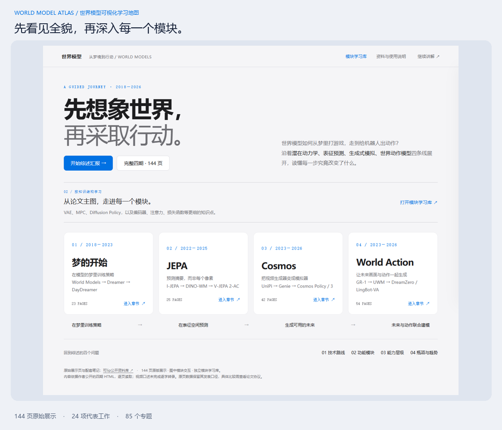
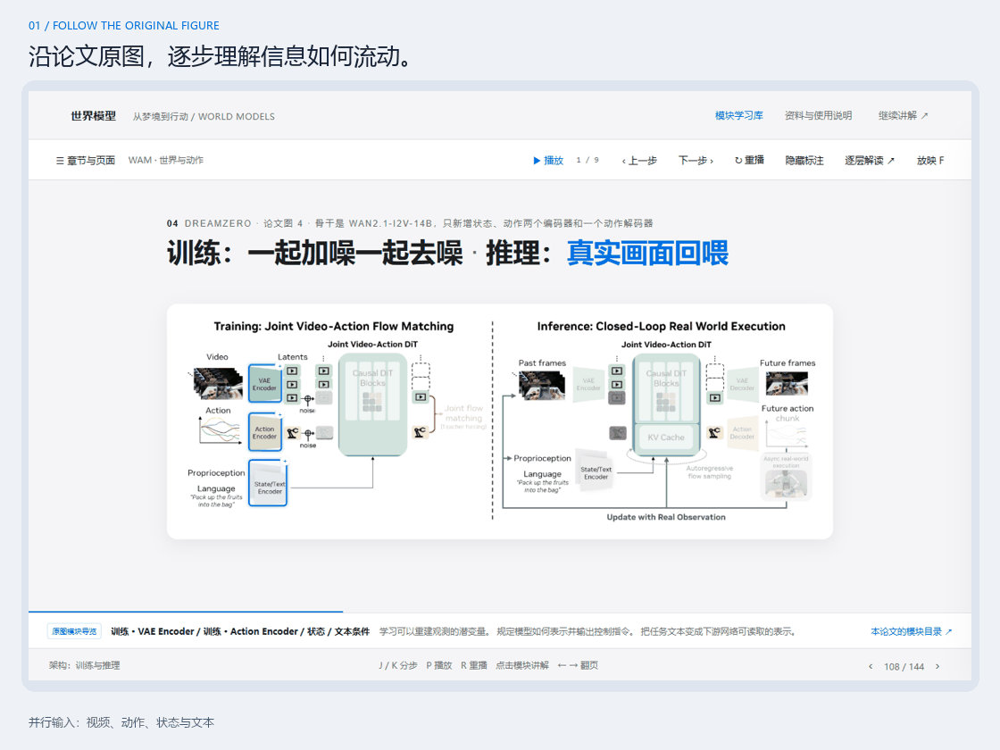
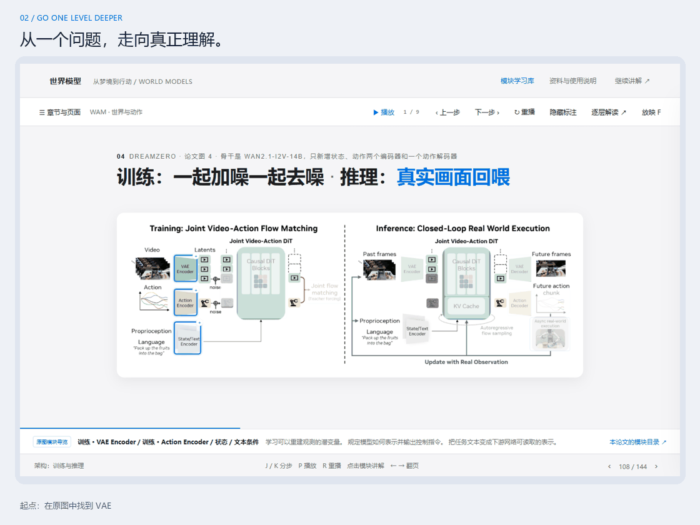
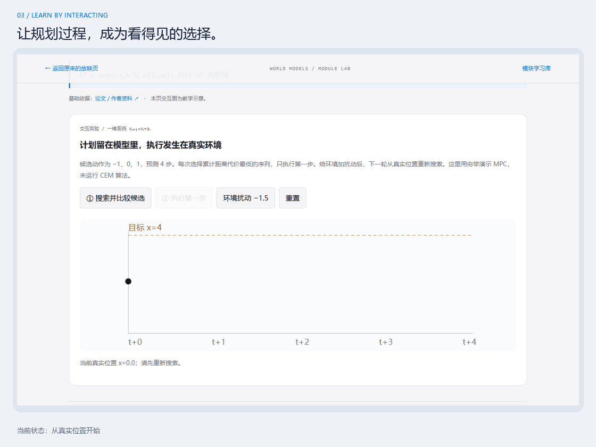
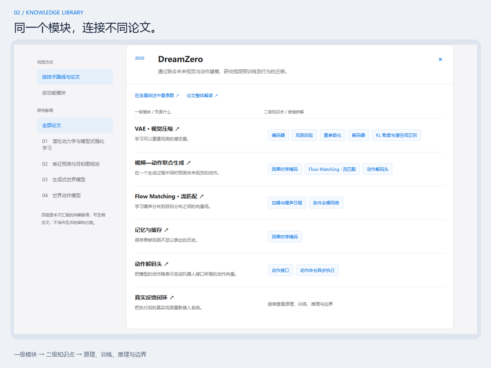
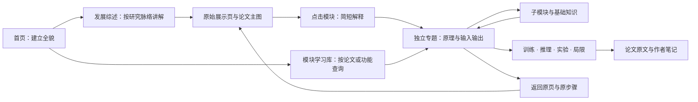
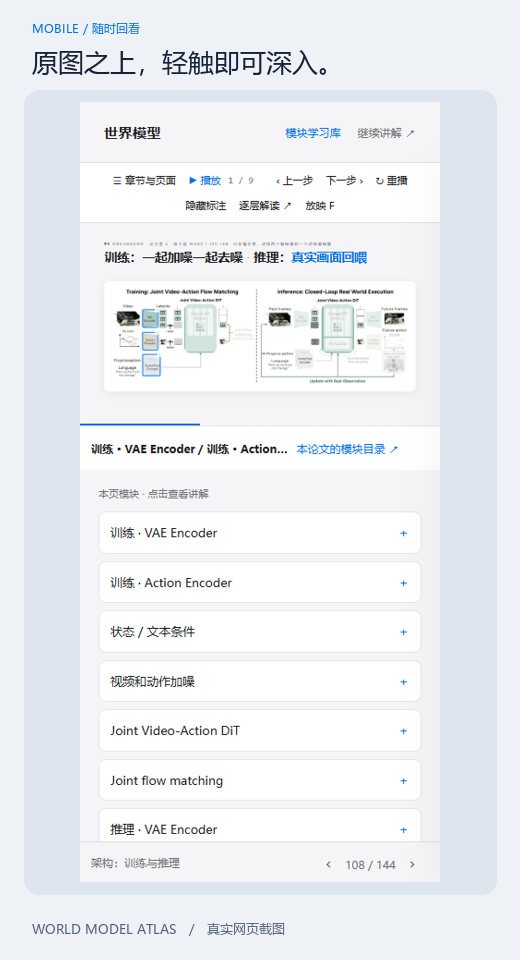

<div align="center">

# 世界模型 · 可视化学习地图

**World Model Atlas**

从入门到读懂论文主图，建立关于世界模型的完整知识地图。

**先看全貌 · 再懂机制 · 最后回到证据**

[](https://github.com/AnthennyGabriel/kelip-wm-state/actions/workflows/pages.yml)


[项目概述](#项目概述) · [动态演示](#动态演示) · [学习路线](#学习路线) · [参考文献](#参考文献) · [本地运行与部署](#本地运行与部署)

</div>



> **144 页原始展示 · 4 条研究脉络 · 24 项代表工作 · 85 个专题**<br>
> 面向初学者、读书小组与科研汇报。通过论文原图、分步讲解和可操作示例，连接“我听过这个词”和“我知道它在系统中做什么”。

## 项目概述

世界模型的论文往往同时涉及视觉表征、时序预测、生成模型、强化学习和机器人控制。初学者需要先知道它们如何联系，深入阅读时又需要能追溯具体模块的输入、输出和训练目标。

这个项目把综述组织成两条互相连接的路径：**发展综述**解释研究为什么一步步走到今天；**模块学习库**解释每一个系统具体如何工作。阅读者可以沿主线前进，也可以从原图中的一个模块钻深，再返回原来的位置继续学习。

我们用四个问题组织全貌：

| 观察角度 | 需要回答的问题 | 阅读时重点看什么 |
| --- | --- | --- |
| 技术路线 | 不同工作分别预测什么、怎样学习、如何决策？ | 表示空间、训练目标、动作条件与决策接口 |
| 功能模块 | 系统由哪些部件构成，信息如何传递？ | 编码、记忆、动力学、解码、策略、价值与规划 |
| 能力层级 | 从预测到交互、规划和迁移，还缺少什么？ | 闭环行为、任务成功率、泛化条件与失败案例 |
| 瓶颈与趋势 | 什么限制了长时预测和真实世界控制？ | 误差累积、数据与动作对齐、计算预算和评测协议 |

四条研究脉络是本项目的**教学组织方式**，会彼此交叉；能力层级也是阅读框架，并非行业统一标准。

## 动态演示

以下 GIF 由真实网页操作截图组成，增加统一的说明边框；它们是节奏化的步骤演示，不是实时录屏。页面与图中内容均来自实际实现。动画首帧也可作为静态预览，完整交互以运行网站为准。[素材与更新方式](docs/MEDIA.md)

### 01 — 沿着原图，看见信息流

保留论文图中的结构、分支和回路。按讲解步骤突出输入、预测、输出与反馈，支持播放、暂停、重播与手动推进。



### 02 — 从一个模块，逐层深入

点击模块先打开简短解释；需要更深的原理时，再进入独立专题。VAE 可以继续拆到观测后验、重参数化和 KL。返回时保留原页码与播放步骤。



### 03 — 动手理解，而不只记住术语

MPC 示例允许比较候选计划、只执行首步、加入环境扰动，再重新规划。VAE 示例展示分布与采样，Diffusion Policy 示例展示动作序列从噪声到结构化的概念过程。



*上述实验为教学示意。MPC 示例采用穷举搜索；扩散示例采用概念插值，没有运行真实机器人或神经网络。*

## 学习路线

| 脉络 | 代表工作 | 这条线帮助你理解 |
| --- | --- | --- |
| **潜在动力学与模型式强化学习** | World Models、PlaNet、Dreamer V1/V2/V3、DayDreamer | 压缩观测、学习动态，在模型中规划或训练策略 |
| **表征预测与目标图规划** | LeCun 2022、I-JEPA、V-JEPA、DINO-WM、V-JEPA 2、LeWorldModel | 抽象表征预测，以及与动作条件、目标和规划的连接 |
| **生成式世界模型** | UniPi、Genie、Cosmos 1、Predict 2.5、Cosmos Policy、Cosmos 3 | 视频、隐动作和生成式环境如何成为交互接口 |
| **世界动作模型** | GR-1、VPP、UWM、DreamZero、LingBot-VA、LingBot-VA 2.0 | 未来视觉与动作如何联合建模，怎样走向闭环执行 |

这一范围来自当前四期材料与补充专题，尚非对世界模型全部研究的穷尽检索。LeWorldModel 为补充知识条目；各工作的证据和覆盖深度请查看原页及配套笔记。

**初次接触：** 首页四条线 → World Models 的 V / M / C → VAE 与 MPC 基础 → 比较后续路线。<br>
**准备汇报：** 四个综述问题 → 43页精选路线 → 原图分步讲解 → 按追问打开模块。<br>
**深入论文：** 学习库选工作 → 一级模块 → 二级知识点 → 训练/推理区别 → 原文与实验边界。



## 内容与交互架构



**主线与细节各有位置。** 主线保持讲解节奏，细节通过小窗与专题逐层展开。<br>
**动效服务理解。** 高亮、顺序和反馈路径帮助读图；不同论文保留自己的架构。<br>
**设计服务阅读。** 浅色画布、蓝色强调、明确的文字层级、留白和一致的操作入口。<br>
**证据可以追溯。** 原始展示、来源笔记与本站教学示意分别说明。

<details>
<summary><strong>手机端与日常操作</strong></summary>

<p align="center"></p>

| 操作 | 功能 |
| --- | --- |
| 鼠标滚轮 / ← → | 翻页，带连续滚动保护 |
| J / K | 下一步 / 上一步 |
| P / R | 播放暂停 / 重播 |
| G | 打开目录，当前页高亮且居中 |
| 点击图中模块 | 打开简短解释，再按需深入 |
| D / F | 本页解读 / 放映模式 |

目录与小窗内保持正常滚动。手机保留原图比例，并提供较大的模块按钮。网页支持系统“减少动态效果”设置。

</details>

## 工程架构

原生 HTML、CSS 与 JavaScript，部署产物为静态文件，没有第三方运行依赖。

| 层 | 关键文件 | 职责 |
| --- | --- | --- |
| 内容 | `data.js`、`chapters/` | 原始展示、图片、视频和笔记 |
| 知识结构 | `lesson-models.js`、`knowledge.js` | 论文、模块、下层知识点与引用 |
| 原图交互 | `figure-map.js`、`original-frame.js` | 模块位置、分步突出与原页动画 |
| 导航与小窗 | `app.js`、`module-ui.js` | 路线、滚轮、目录、弹窗与状态恢复 |
| 深入学习 | `library.*`、`lesson*.js`、`module.html` | 学习库、专题和交互实验 |
| 构建发布 | `scripts/`、`.github/workflows/` | 验证资源与模块关系，构建并发布静态产物 |

## 本地运行与部署

需要 Node.js 22+。克隆仓库后运行，无需安装前端依赖：

```sh
npm run build
npm start
```

打开 **http://127.0.0.1:8766/**。模拟仓库子目录可运行 `npm run preview:pages`。

GitHub Pages、Vercel、Netlify 等平台可使用 `npm run build`，产物在 `dist/`。每次推送自动检查，GitHub Pages 正式发布通过 **Run workflow** 手动触发。完整操作见 **[部署指南](docs/DEPLOYMENT.md)**。

> 当前 README 不将预期域名当作已上线地址；发布结果以仓库 Actions 的部署状态为准。

## 参考文献

以下原文适合作为入门阅读的锚点；完整工作与来源笔记见 **[参考文献索引](docs/REFERENCES.md)**。

| 阅读主题 | 原文 / 官方资料 | 与本站的联系 |
| --- | --- | --- |
| 世界模型的早期范式 | [World Models](https://worldmodels.github.io/) | VAE、MDN-RNN、控制器与梦境训练 |
| 从潜空间学习行为 | [Dreamer V3](https://danijar.com/project/dreamerv3/) | 想象轨迹、策略与价值学习 |
| 表征与规划 | [V-JEPA 2](https://arxiv.org/abs/2506.09985) | 区分预训练表征与动作条件后训练 |
| 视觉压缩基础 | [Auto-Encoding Variational Bayes](https://arxiv.org/abs/1312.6114) | 后验、重参数化与 KL |
| 动作生成基础 | [Diffusion Policy](https://diffusion-policy.cs.columbia.edu/) | 条件去噪、动作块与滚动执行 |
| 生成式建模基础 | [Flow Matching for Generative Modeling](https://arxiv.org/abs/2210.02747) | 概率路径与速度场 |

## 范围、来源与后续建设

当前已实现：原始展示保留、关键原图模块交互、双入口学习结构、专题与实验、状态恢复、响应式导航及静态部署。构建检查覆盖144页、85个专题和媒体引用；浏览器检查覆盖子目录资源、模块深入与返回、滚轮、目录定位和视频分段读取。

下一阶段计划（尚未实现）：

- [ ] 为每项工作补齐统一的比较卡：数据、目标、预测对象、动作接口、评测边界。
- [ ] 建立更细的初学者先修路径、术语检索与阅读进度。
- [ ] 扩大代表工作覆盖，并逐项复核原文、版本与实验协议。
- [ ] 增补长时误差、不确定性、接触动力学等可操作示例。

原始展示与笔记来自 **[可lip公开资料库](https://github.com/skJack/-lip-)**，固定来源提交 `fc02c1e70c15f677fc752373363eedda43d247dd`。本项目新增了学习导航、原图交互、模块专题和教学实验。没有完整转录原视频的两小时口述，公开HTML可能与录屏版本有差异。

第三方论文图、视频及原始资料的权利归各自作者；保留原署名和各章使用说明。本仓库未授予这些材料新的使用许可。课堂或论文引用研究结论时，请引用对应论文原文。

---

<div align="center">让初学者看见全貌，让深入学习始终有路可循。</div>
